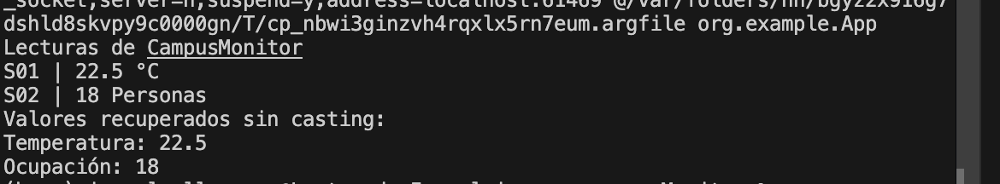

### Qué representa la clase Lectura<T>.

Para mi represnta una clase generica que llega a tener 3 atributos con sus contructores y getters

## Qué representa T y por qué permite utilizar la misma clase para temperatura y ocupación.

Representa una clase generica y permite utilizar temperatura y ocupacion ya que permite diferentes tipos de datos al mismo tiempo sin crear nuevas instancias de clases

## Qué agregaste en App.java.

Agrege la clase Lectura con una instancia, le di tipo de datos de Double y Integer y fui imprimiendo cada tipo de valor y unidad 

