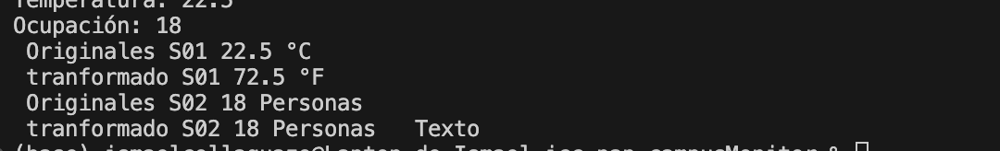

## En un párrafo breve, explica qué representa R y por qué transformar es genérico aunque runTransformaciones no lo sea. Indica qué agregaste en Lectura y App.

La R representa un tipo de dato generico que se da como un resultado de lo que se tranforma el tipo T a tipo R llega a utilizar funtion llegando a que se tranforme una lectura de tipo T en R, y en el Lectura se agrego el public <R> Lectura<R> transformar(Function<T, R> conversor, String nuevaUnidad) y en el app se puso el metodo private static void runTransformaciones() que ejecutará el programa  y irá imprimiendo cada parte de los grados y unidades tranformadas

